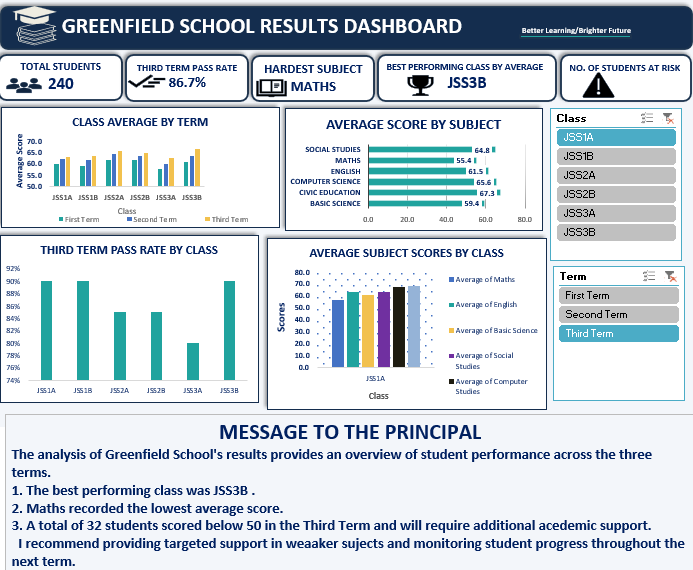

# GreenField_School_Result_Excel_Analysis
## Project Overview
This project is an Excel Analysis of GreenField School Results that focuses on cleaning, organizing the dataset.
The project aim to improve data quality and evaluate students academic performance across different terms, classes, and subjects.
It demonstrates how Excel can be used to transform data results into meaaniful information for understanding students academic performance.

---
## Business Questions Answered
- Question 1. Which class is doing best, and which class needs the most help?
- Question 2. Which subject is the hardest for students?
- Question 3. Are students improving from First Term to Third Term?
- Question 4. Which students need extra support?

---
## Key KPIs
- Total Students
- Third Term Pass Rate
- Hardest Subject
- Best Performing Class By Average
- Number of Students at Risk

---
## Tools
- Microsoft Excel
- Excel PivotTable
- Excel Charts
- KPIs
- Interactive Slicers
- Dashboard Design Technique

---
## Dashboard Preview
-

---
## Key Insights
- Total number of students is 240.
- Maths is the hardest subjects for students while Civic Education is the easiest for students.
- Total Number of students at risk is 32.

---
## Files In The Repository
-[Excel Workbook](Results_OligbiPatience.xlsx)
-[Dashboard Screenshot](Dashboard.png)
- README.md

---
## Conclusion
This project highlights practical skills in data cleaning, data validation, formula based calculations, PivotTables, Charts, and Data visualization. These skills can better support organizations and interpretation of academic results. 
